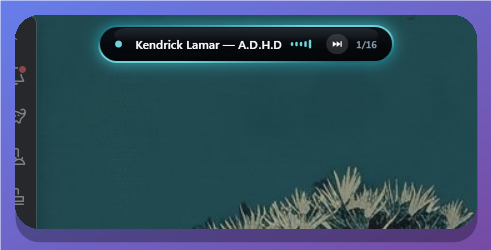
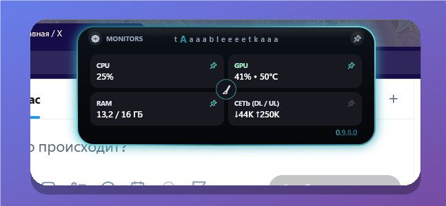

# Egor Gribkov (`eggrib` / `699718`)

**Indie Software Engineer · Go · C# (.NET 8 / WPF) · Python · Self-Hosted Infrastructure**

Building fast native desktop tools, Telegram bots, Web Audio instruments, and algorithmic systems — with zero Electron bloat.

---

## Featured Project: [`tabletka`](https://github.com/eggrib/tabletka)

> **Native 60-FPS Dynamic Island & 16-in-1 desktop widget pill for Windows (.NET 8 / WPF)**

| Compact Capsule on Desktop | Hardware Monitors (CPU / GPU / RAM / Net) |
| :---: | :---: |
|  |  |

- **Native .NET 8 / WPF** — lightweight idle footprint, smooth 60-FPS animations, Per-Monitor V2 DPI & fullscreen game awareness
- **16 built-in modules** — media player with live lyrics, Gaming Mode Glow (4 neon palettes + priority boost), File Shelf, clipboard manager, snippets, screen recorder, hardware HUD, and timers
- **10 UI languages** (`EN`, `RU`, `DE`, `FR`, `ES`, `HE`, `JA`, `KO`, `ZH`, `TR`) + optional Android companion sync via WebSockets (`Go + Redis`)

👉 **[Download tabletka for Windows (Free)](https://tabletka.699718.space/?utm_source=github&utm_medium=profile&utm_campaign=eggrib_profile)** · **[Repository & Changelog](https://github.com/eggrib/tabletka)**

---

## Projects & Ecosystem

| Project | What it does | Stack | Links |
| :--- | :--- | :--- | :--- |
| **[tabletka](https://github.com/eggrib/tabletka)** | Native 60-FPS Dynamic Island & 16-in-1 desktop widget hub for Windows | `C#` `.NET 8` `WPF` | [Download](https://tabletka.699718.space/?utm_source=github&utm_medium=profile&utm_campaign=eggrib_profile) · [Repo](https://github.com/eggrib/tabletka) |
| **tabletkaCompanion** | Native Android companion & PC remote via QR + `relay.699718.space` | `Kotlin` `Compose` | [Android Page](https://699718.space/companion.html?utm_source=github&utm_medium=profile&utm_campaign=eggrib_profile) |
| **tabletkaConnect** | Instant remote access key service (EU/DE) with 2-hour free trial | `Go` `Fiber` `SQLite` | [Try 2h Free](https://shop.699718.space/?utm_source=github&utm_medium=profile&utm_campaign=eggrib_profile) |
| **[MAS_699](https://github.com/eggrib/MAS_699)** | Multi-agent LLM debate & orchestration bot in Telegram (`@mas699bot`) | `Go` `Redis` | [Open Bot](https://t.me/mas699bot) · [Repo](https://github.com/eggrib/MAS_699) |
| **[shazam699_bot](https://github.com/eggrib/shazam699_bot)** | Fast Telegram bot for music recognition & audio lookup (`@Shazam699_bot`) | `Go` `Telegram API` | [Open Bot](https://t.me/Shazam699_bot) · [Repo](https://github.com/eggrib/shazam699_bot) |
| **[DubSynt699](https://github.com/eggrib/DubSynt699)** | Roots Radics–inspired dub synthesizer running straight in the browser | `JavaScript` `Web Audio` | [Repo](https://github.com/eggrib/DubSynt699) |
| **[civdem](https://github.com/eggrib/civdem)** | Evolutionary demography simulation & ABC-SMC calibration pipeline | `Python` `NumPy` | [Demo](https://699718.space/simple-v3.html?utm_source=github&utm_medium=profile&utm_campaign=eggrib_profile) · [Repo](https://github.com/eggrib/civdem) |
| **[bitget-bot-gridbot](https://github.com/eggrib/bitget-bot-gridbot)** | Containerized multi-pair grid trading bot for Bitget | `Go` `Docker` | [Repo](https://github.com/eggrib/bitget-bot-gridbot) |

---

## Core Tech Stack

---

  Open to interesting engineering projects (Go / Python / .NET 8) and feedback on <strong>tabletka</strong> — reach out at <a href="https://t.me/eggrib">@eggrib</a> or explore <a href="https://699718.space/?utm_source=github&utm_medium=profile&utm_campaign=eggrib_profile">699718.space</a>.

